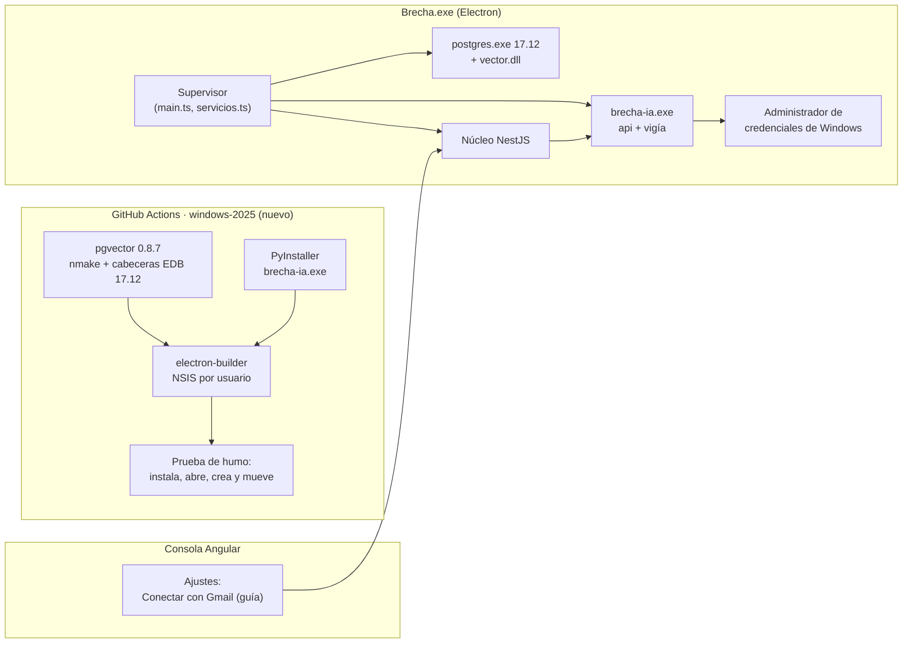

# Brecha en Windows (W): instalador, PostgreSQL con pgvector, servicio con IA y Gmail guiado

> Documento técnico de la tarea. El plan para Juan está en el artifact «Brecha en Windows» (G-PLAN-ARTIFACT).
> Rama `windows` (cortada de `f2`), PR borrador hacia `f2` (JustHipo/brecha#5 sigue abierta).
> Estado: **plan validado por Juan el 24-nov-2026** («Continuar» y respuestas en el artifact).

## 1. Pedido

Juan quiere que Tamara use Brecha en su Windows con la llave de OpenAI de Juan y su propia cuenta de Gmail (las credenciales y el gasto son de Juan, G-CUENTAS). D17 dice «macOS primero; Windows si no es muy complicado». Este documento es la evaluación y el plan.

**Hecho cuando:** el instalador que sale del CI instala y abre Brecha en un Windows limpio; el modo liviano (bandeja del sistema con PostgreSQL, núcleo y vigía) y el completo (ventana con la consola y la API de IA) levantan; Gmail se conecta con la guía; una postulación se crea y se mueve en el tablero.

## 2. Fuentes leídas

| Fuente | Qué saqué |
|---|---|
| `docs/PLAN.md` (D17, D19, D36 a D40) | Windows era opcional; D39 dice «solo macOS» en `allowBuilds` (`electron-winstaller: false`) |
| `docs/adr/0017-app-escritorio-electron.md` | Lo caro de Windows es empaquetar PostgreSQL y Python |
| `apps/escritorio/**` (main, servicios, base-de-datos, proceso, rutas, hooks, scripts) | Lista de supuestos de macOS en §4 |
| `services/ia` (spec de PyInstaller, `empaquetar.sh`, `servicio.py`, `llavero.py`, `api.py`) | El llavero ya va por `keyring`; la API ya prueba las credenciales antes de guardarlas y nunca las devuelve |
| `apps/consola/.../ajustes/ajustes.ts` | Ajustes ya tiene los formularios de Gmail y OpenAI; falta la guía paso a paso |
| `@embedded-postgres/windows-x64@17.12.0-beta.19` (descargado y revisado) | PostgreSQL 17.12 compilado con MSVC; trae `initdb.exe`, `pg_ctl.exe`, `postgres.exe`; **no trae `include/` ni `postgres.lib`**: no sirve para compilar pgvector |
| README oficial de pgvector (v0.8.7) | En Windows no hay binarios oficiales: se compila con `nmake /F Makefile.win` y `PGROOT` apuntando a un PostgreSQL con cabeceras; con 17.0 a 17.2 falla el enlace (17.3+ sirve) |
| `actions/runner-images`, Windows2025-VS2026-Readme (imagen 20261116) | `windows-2025` trae PostgreSQL 17.12 en `PGROOT=C:\Program Files\PostgreSQL\17` (servicio detenido) y VS 2026 con VC.Tools x86.x64: se compila pgvector ahí. Plan B: zip de EDB 17.12-1 (existe, 386 MB) |
| Microsoft Learn: smartscreen-reputation (2026-08-17), Smart App Control overview (2026-10-06), Artifact Signing quickstart y FAQ (2026-11-20); precios por la API de Azure; código de electron-builder 26.18.0 | §7 |
| AIOS: lecciones de brecha (PostgreSQL embebido, Electron 45 con pnpm 11, llavero sin firma), manuales de pnpm, node y github | `allowBuilds` para los postinstall; `pnpm deploy --legacy`; un paquete de un solo sistema va en `optionalDependencies`; el token de `gh` ya tiene `workflow` |

No leído o no verificable desde el Mac: el comportamiento real en un Windows limpio (se prueba en el CI y en el equipo de Tamara).

## 3. Diagrama

Colores en el artifact: nuevo (CI de Windows, guía de Gmail, icono de bandeja), modificado (supervisor, scripts de empaquetado, spec de PyInstaller, hooks), contexto (núcleo, consola, macOS sin cambios).

## 4. Supuestos de macOS encontrados en el código

| Dónde | Hoy | En Windows |
|---|---|---|
| `servicios.ts` | `bin/postgres` | `bin/postgres.exe` |
| `proceso.ts` | Para PostgreSQL con `SIGINT` | Node en Windows mata el proceso (TerminateProcess) con cualquier señal: PostgreSQL se cae sin cerrar y hace recuperación al volver. Usar `pg_ctl stop -m fast` |
| `proceso.ts` / supervisor | Los hijos mueren con la app | En Windows los hijos no mueren si Electron se cae: quedan huérfanos con los puertos tomados. Al iniciar, detener los de la vez anterior |
| `servicios.ts` `servicioDelLlavero` | Entrada `brecha-app-<huella del binario>` por el control de acceso del llavero de macOS | El Administrador de credenciales no tiene control por app: con la huella, cada actualización pediría las credenciales de nuevo. En Windows, entrada fija `brecha-app` |
| `main.ts` | `wasOpenedAtLogin` para arrancar callada | Solo existe en macOS: usar un argumento `--oculta` en `setLoginItemSettings` |
| `main.ts` | Icono plantilla (negro) y el número en `tray.setTitle` | En Windows el icono plantilla no se ve en la barra oscura y `setTitle` no existe: icono a color `.ico`, número en el tooltip, clic abre la ventana |
| `main.ts` | Avisos del sistema | Windows pide `app.setAppUserModelId` para mostrarlos |
| `hooks.ts` | `/bin/sh -c` | `cmd.exe /d /s /c` |
| `scripts/empaquetar.mjs` | `execFileSync('pnpm')`, `--mac dmg` | En Windows `pnpm` es `pnpm.cmd` (necesita `shell`); `--win nsis` |
| `scripts/preparar-postgres.mjs` | pgvector de Homebrew | `vector.dll` compilada en el CI |
| `scripts/despues-de-empaquetar.cjs` | Copia a `Brecha.app/Contents/Resources` | En Windows, `win-unpacked/resources` |
| `services/ia/brecha-ia.spec`, `empaquetar.sh` | `target_arch="arm64"`, solo Darwin | Arquitectura según el sistema; `brecha-ia.exe` |
| `servicio.py comprobar` | Revisa que cargue el llavero de macOS | Revisar `keyring.backends.Windows` en Windows |
| `almacen-de-tokens.ts`, `claves()` | Permisos 0600 | No aplican en Windows; `%APPDATA%` ya es solo del usuario (ACL del perfil) |

## 5. Plan por fases (un checkpoint por fase)

### W1. Supervisor multiplataforma (sin romper macOS)
- `rutas.ts`: nombres de ejecutables por sistema (`exe()`), `ia/brecha-ia.exe`.
- Puerto de PostgreSQL: 5434 por defecto; si está ocupado o reservado (Windows reserva rangos con Hyper-V o WSL, `netsh int ipv4 show excludedportrange`), el supervisor elige uno libre y lo guarda en `instancia/puertos.json`. Solo lo usan el núcleo y la IA, que lo reciben del supervisor. 4300 y 4400 quedan fijos (los conocen la consola y el MCP): si están tomados, error claro en el menú.
- Parada de PostgreSQL con `pg_ctl stop -D … -m fast` (en los dos sistemas: es lo que recomienda PostgreSQL).
- Huérfanos: `instancia/procesos.json` con los PID; al iniciar, si siguen vivos y son de Brecha, se detienen. Si `postmaster.pid` apunta a un PostgreSQL vivo, `pg_ctl stop`.
- Llavero: entrada fija `brecha-app` en Windows.
- `main.ts`: icono `.ico`, clic abre, tooltip con pendientes, `--oculta`, `setAppUserModelId`.
- `hooks.ts`: `cmd.exe` en Windows.
- Pruebas unitarias (vitest) de todo lo anterior con `process.platform` simulado.
- Verificación: `pnpm turbo run lint typecheck test` y el `.app` de macOS se arma y abre igual (`empaquetar.mjs`, salida aparte).

### W2. Servicio con IA para Windows
- `brecha-ia.spec`: `target_arch` según el sistema; `keyring.backends.Windows` y `win32ctypes.pywin32.win32cred` en `hiddenimports`.
- `empaquetar.sh` acepta Git Bash en Windows (o un `empaquetar.py` multiplataforma) y corre `brecha-ia.exe comprobar`.
- `comprobar` exige el llavero de Windows en Windows.
- Prueba (pytest) de que ni la clave de Gmail ni la llave de OpenAI aparecen en los logs ni en las respuestas de error.

### W3. PostgreSQL con pgvector para Windows
- `@embedded-postgres/windows-x64@17.12.0-beta.19` en `optionalDependencies` y en `allowBuilds`.
- `preparar-postgres.mjs` por sistema: en Windows copia `vector.dll` a `lib/` y `vector*.sql|control` a `share/extension/` desde la carpeta que deja el CI (`PGVECTOR_DIR`).
- Script del CI: compila pgvector v0.8.7 con `nmake /F Makefile.win` (vcvars64 ubicado con `vswhere`) contra el `PGROOT` del runner; el job falla si ese PostgreSQL no es 17.12 (plan B: zip de EDB 17.12-1).
- Verificación en el CI: `initdb` + `postgres.exe` embebido, `CREATE EXTENSION vector`, una tabla con `vector(3)`, índice HNSW y una consulta `<->`. Si falla, el job falla.

### W4. Instalador NSIS y CI de Windows
- `package.json` (build): `win: { target: nsis, icon }`, `nsis: { oneClick: true, perMachine: false }` (se instala en `%LOCALAPPDATA%\Programs\Brecha` sin pedir administrador), `artifactName` sin espacios (GH-RELEASE-ESPACIOS).
- `allowBuilds`: `electron-winstaller` sigue en `false` (es de Squirrel, NSIS no lo usa); se corrige el comentario de D39.
- `.github/workflows/windows.yml` en `windows-2025`: instala, compila, arma el instalador y lo sube como artefacto (`Brecha-Setup-<versión>.exe`, 30 días).
- Prueba de humo en el mismo job: instala en silencio (`/S`), abre Brecha con datos en una carpeta con espacios y tildes, espera `GET /api/v1/salud` (núcleo) y `GET /api/ia/salud` (IA), crea una postulación y la mueve por la API REST con el token de la instancia, guarda una captura de la ventana (`BRECHA_CAPTURA`) como artefacto, cierra Brecha y revisa que no queden procesos.
- El CI actual (Ubuntu) no cambia.

### W5. Conectar con Gmail en Ajustes
- Botón «Conectar con Gmail» que abre una guía en 4 pasos dentro de la tarjeta del correo:
  1. Activar la verificación en dos pasos (enlace a `myaccount.google.com/signinoptions/twosv`).
  2. Abrir `myaccount.google.com/apppasswords`.
  3. Crear una contraseña de aplicación con el nombre «Brecha» y copiar las 16 letras.
  4. Escribir tu Gmail y pegar la contraseña: se prueba contra Gmail antes de guardarla.
- La contraseña va en un campo de tipo contraseña, se borra del formulario apenas se envía (salga bien o mal), nunca vuelve desde la API y no se escribe en archivos ni logs. Cada persona usa su propia cuenta.
- Errores con salida: verificación en dos pasos sin activar (Google no muestra la página de contraseñas), contraseña mal copiada, cuenta de trabajo o de estudios que no permite contraseñas de aplicación.
- Pruebas: vitest del store y de la guía; Playwright del flujo con la API de IA simulada.
- OpenAI: sin cambios de fondo (ya está en Ajustes); se revisa que tampoco quede en logs.

### W6. Prueba en un Windows real y cierre
- Juan o Tamara bajan el instalador del CI, instalan, abren, conectan Gmail con la guía, Juan pone su llave de OpenAI, crean y mueven una postulación.
- Prompt para la sesión de Claude de Tamara (pedido de Juan, 24-nov-2026): que se conecte con esta sesión por remote control, haga preguntas y la guíe paso a paso hasta tener todo arriba: instalar la app, conectar OpenAI (llave de Juan), Claude (MCP) y su Gmail sin desconectar el de Juan, usar la app, importar las postulaciones de ambos y convertir las suyas al formato que acepta la importación (de la sesión de CSV).
- Decisiones nuevas en `docs/PLAN.md` (D49 en adelante), ADR 0017 actualizado, README con la instalación en Windows, lecciones a la bandeja del AIOS.

## 6. Riesgos

| Riesgo | Qué puede pasar | Cómo se trata | Cómo se prueba |
|---|---|---|---|
| Firma | SmartScreen muestra «Windows protegió su PC»; Smart App Control puede bloquear | Ver §7; decisión de Juan | En el equipo de Tamara |
| pgvector compilado aparte | `vector.dll` no carga en el PostgreSQL embebido | Misma versión menor (17.12) y mismo compilador MSVC | Prueba de pgvector en el CI (W3) |
| Rutas | Usuario con tildes o espacios (`C:\Users\Tamara Pérez`); rutas de más de 260 caracteres en `node_modules` | Datos de prueba en una carpeta con tildes; núcleo con `node-linker=hoisted` (sin `.pnpm` anidado ni enlaces) | Prueba de humo (W4) |
| Permisos | `postgres.exe` se niega a correr con permisos de administrador elevados | Instalador por usuario, sin elevar; mensaje claro si pasa | Prueba de humo; nota en el README |
| Puerto de PostgreSQL | 5434 tomado o en un rango reservado por Hyper-V/WSL | Puerto libre guardado en la instancia | Prueba unitaria y de humo |
| Puertos 4300/4400 | Tomados por otra app | Error claro en el menú de la bandeja | Prueba unitaria |
| Procesos huérfanos | Si Brecha se cae, PostgreSQL y el núcleo siguen vivos | Se detienen al volver a abrir | Prueba de humo (cierre forzado) |
| Antivirus | Defender puede marcar un ejecutable de PyInstaller sin firmar como sospechoso | Sin UPX (ya está así); si pasa, se reporta como falso positivo a Microsoft | En el equipo de Tamara |
| CI de macOS | No hay job de macOS hoy: el riesgo es romper el empaquetado local de macOS | Cambios por sistema con pruebas; empaquetar en el Mac antes de cerrar cada fase | Ver pregunta a Juan sobre un job de macOS |
| Firewall | Windows podría preguntar por acceso a la red | Todo escucha solo en 127.0.0.1 | Prueba en el equipo de Tamara |

## 7. Firma del instalador

Verificado el 24-nov-2026:
- **Sin firma:** SmartScreen muestra «Windows ha protegido su PC» y «Ejecutar de todos modos» (Learn, smartscreen-reputation). Cada versión parte sin reputación.
- **Azure Artifact Signing:** Basic 9,99 USD/mes (API de precios de Azure). Individuos solo de EE. UU. y Canadá; organizaciones de una lista que no incluye a Chile (FAQ y quickstart). No aplica.
- **OV:** llave en hardware obligatoria desde 2023 (CA/B Forum CSBR 6.2.7.4.2); SSL.com 129 USD/año + YubiKey 379 USD o eSigner. OV ni EV quitan el aviso de inmediato: la reputación se gana con semanas y cientos de instalaciones (Learn).
- **Smart App Control:** bloquea apps sin firmar sin excepción por app; apagarlo ya se puede revertir sin reinstalar, salvo con los datos de diagnóstico opcionales apagados (soporte de Microsoft y Learn, 2026-10-06).
- **Recomendación (Claude):** sin firma; revisar Smart App Control en el equipo de Tamara antes de instalar. Decide Juan.

## 8. Decisiones

| # | Decisión | Autor |
|---|---|---|
| W-a | Windows sí, para Tamara, con la llave de OpenAI de Juan y su propio Gmail | Juan |
| W-b | Instalador NSIS con electron-builder; PyInstaller en un runner Windows; instalador como artefacto del CI | Juan |
| W-c | Credenciales en el Administrador de credenciales de Windows con `keyring` | Juan |
| W-d | pgvector compilado en el CI contra el PostgreSQL 17.12 del runner (no hay binario oficial de Windows) | Claude |
| W-e | Instalador por usuario (sin administrador), en `%LOCALAPPDATA%\Programs\Brecha` | Claude |
| W-f | Puerto de PostgreSQL elegido al vuelo si 5434 no sirve; 4300 y 4400 fijos | Claude |
| W-g | En Windows, entrada fija `brecha-app` en el llavero | Claude |
| W-h | Parada de PostgreSQL con `pg_ctl stop -m fast` y limpieza de huérfanos al iniciar | Claude |
| W-i | Prueba de humo automática en el runner de Windows | Claude |
| W-j | Sin firma por ahora; revisar Smart App Control en el equipo de Tamara antes de instalar | Juan |
| W-k | La prueba en un Windows real es directo en el equipo de Tamara, después de que el CI pase | Juan |
| W-l | Job de macOS en el CI que arma el .dmg en cada PR | Juan |
| W-m | El CI de Windows corre en PRs que tocan la app, la IA o la consola, y a mano | Juan |
